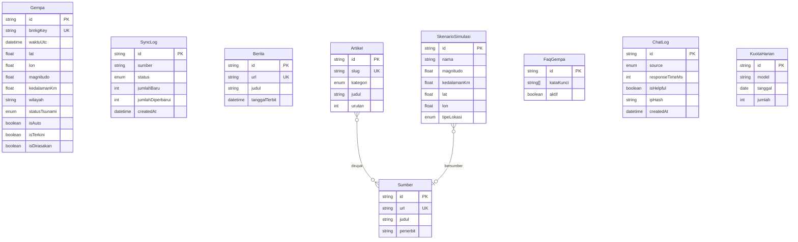

# PRD: Database, Infrastruktur & Fitur Sistem — SIGAP Gempa

Versi 1.1 (Final) · 2026-11-10 · Pelengkap `PRD.md` (bagian 1–13). Menggantikan asumsi lama "database belum wajib" dan menyatukan: lapisan data, simulasi dampak gempa, chatbot kontekstual, dan instrumen evaluasi untuk laporan.

**Perubahan dari v1.0:** keputusan terbuka diputuskan (bagian 2); fase pengerjaan ditambahkan; `Gempa` memakai flag klasifikasi dan kunci `DateTime`; `SyncLog` menggantikan `SyncStatus`; FAQ statis sebagai fallback terakhir; ERD lengkap; label dan rumus simulasi dijelaskan; keamanan feedback dan health check diperketat; uji bertambah menjadi 20.

---

## 1. Ringkasan

SIGAP Gempa adalah website informasi gempa bumi Indonesia. Dokumen ini menambahkan **PostgreSQL** (via **Prisma**) sebagai database utama dan **Redis** (opsional) untuk data sementara. Seluruh sistem, termasuk Next.js, berjalan di satu VPS dengan **Docker Compose**. MySQL tidak dipakai.

### 1.1 Tujuan
1. Menyimpan **riwayat gempa** BMKG agar tetap tampil saat BMKG tidak dapat diakses, serta bisa difilter dan dibuat grafik.
2. Mengelola **konten** (berita, edukasi, sumber, FAQ, skenario simulasi) tanpa deploy ulang.
3. Membuat **chatbot hemat kuota dan kontekstual**: konteks gempa terkini, rate limit, penghitung kuota harian, fallback bertingkat.
4. Menyediakan **simulasi gempa interaktif** sebagai edukasi: estimasi intensitas (MMI), energi, radius dampak, waktu rambat gelombang P dan S, indikator potensi tsunami, dan perbandingan ketahanan bangunan.
5. Menjadi bahan **laporan kuliah** yang terukur: arsitektur, ERD, log sinkronisasi, evaluasi performa dan kepuasan chatbot.

### 1.2 Bukan tujuan
- Login/akun pengguna dan halaman admin.
- Data realtime lewat database: `autogempa` tetap diambil langsung dari BMKG dengan cache.
- Prediksi gempa. Simulasi hanya **estimasi edukasi**, bukan data resmi.
- Memakai MySQL.

---

## 2. Keputusan

| # | Topik | Keputusan |
|---|---|---|
| 1 | Pembaruan data BMKG | **Cron di VPS** memanggil endpoint sinkronisasi tiap 5 menit (dilindungi `SYNC_SECRET`). Lazy refresh sebagai cadangan bila data terakhir lebih dari 10 menit. |
| 2 | Halaman admin | **Tidak ada.** Konten diubah lewat seed atau Prisma Studio via SSH tunnel. |
| 3 | Lokasi deploy | **Next.js ikut Docker di VPS yang sama.** Postgres tidak dibuka ke internet. |
| 4 | Retensi `ChatLog` | **30 hari.** Ringkasan evaluasi (jumlah chat, rasio 👍/👎, rata-rata `responseTimeMs`) diekspor ke laporan sebelum data dihapus. |
| 5 | Reset kuota Gemini | **Perlu diverifikasi** di dokumentasi resmi Google sebelum fase 3. Zona waktu disimpan sebagai konstanta yang mudah diganti. |
| 6 | Domain & HTTPS | **Caddy** bila ada domain. Bila tidak, demo lewat IP/port 80. |
| 7 | Sumber `Berita` | **Input manual** (seed/Prisma Studio). Tanpa scraping atau RSS. |
| 8 | Rate limit chatbot | **10 pesan per menit per IP.** In-memory sampai Redis aktif (fase 5). Tahan restart hanya jika Redis dipakai. |
| 9 | Sumber kebenaran sinkronisasi | **Postgres** (`SyncLog`). Redis hanya cache turunan. |
| 10 | Rumus simulasi | Memakai rumus empiris sederhana yang **dicantumkan di laporan** (lihat 6). Semua hasil diberi label "estimasi edukasi, bukan data resmi". |
| 11 | `/api/health` publik | Hanya mengembalikan `healthy`/`degraded`. Detail (error, waktu sinkronisasi) hanya untuk permintaan dengan `SYNC_SECRET`. |

---

## 3. Keputusan teknologi

| Komponen | Keputusan | Alasan singkat |
|---|---|---|
| Database utama | PostgreSQL | Tipe data kaya (timestamp, array, JSON) |
| ORM | Prisma | Skema deklaratif, migrasi, tipe TypeScript otomatis |
| Cache/pembatas | Redis (opsional, fase 5) | `INCR` + `EXPIRE`, TTL untuk cache dan kuota |
| Kontainer | Docker + Docker Compose | Lingkungan dev dan produksi sama |
| Reverse proxy | Caddy (opsional) | HTTPS otomatis |
| Cache tanpa Redis | `revalidate` bawaan Next.js | Cache `autogempa` dan `terkini` di fase 1–4 |
| MySQL | Tidak dipakai | Tumpang tindih dengan Postgres |

---

## 4. Fase pengerjaan

| Fase | Isi | Kebutuhan terkait |
|---|---|---|
| 1 | Docker Compose, Postgres, Prisma, `Gempa`, `SyncLog`, sinkronisasi BMKG, halaman riwayat, fallback saat BMKG gagal, `/api/health` | FR-DB-01–04, 22 |
| 2 | Konten: `Berita`, `Artikel`, `Sumber`, `FaqGempa`, seed idempoten, FAQ statis | FR-DB-05–08, 14 |
| 3 | Chatbot: fallback bertingkat, `ChatLog`, `KuotaHarian`, rate limit in-memory, konteks gempa terkini, feedback 👍/👎 | FR-DB-09, 11, 12, 20, 21 |
| 4 | Simulasi: `SkenarioSimulasi`, halaman simulasi, tautan dari riwayat dan ke chatbot | FR-DB-16–19 |
| 5 | Redis (opsional): rate limit, kuota, cache BMKG, cache chatbot | FR-DB-10, 13 |
| 6 | Hardening: backup dan uji restore, firewall, uji penerimaan penuh | FR-DB-15, TC-DB-01–20 |

Fase 5 boleh dilewati; semua kebutuhan **Wajib** tetap terpenuhi.

---

## 5. Kebutuhan fungsional

| ID | Kebutuhan | Prioritas |
|---|---|---|
| FR-DB-01 | Data gempa BMKG disimpan ke `Gempa` dengan **upsert**; kunci unik = `bmkgKey` (lihat 7.1). Bila BMKG merevisi magnitudo/koordinat, baris yang sama diperbarui. | Wajib |
| FR-DB-02 | Halaman riwayat membaca dari database (filter magnitudo, rentang tanggal, wilayah) dengan paginasi. | Wajib |
| FR-DB-03 | Jika BMKG gagal diakses, halaman menampilkan data terakhir dari database dengan keterangan "data terakhir disinkronkan <waktu>" berdasarkan `SyncLog` (sinkronisasi sukses terakhir). | Wajib |
| FR-DB-04 | Sinkronisasi lewat cron (+ lazy refresh cadangan), tanpa duplikat. Setiap eksekusi dicatat di `SyncLog`. | Wajib |
| FR-DB-05 | `Berita` menyimpan metadata saja (judul, sumber, tanggal, URL, ringkasan singkat). | Wajib |
| FR-DB-06 | Konten edukasi disimpan di `Artikel` per kategori dan slug. | Wajib |
| FR-DB-07 | `Artikel` terhubung ke satu atau lebih `Sumber`; daftar pustaka dihasilkan dari tabel ini. | Wajib |
| FR-DB-08 | Fallback chatbot membaca `FaqGempa` dari database. **Bila database tidak terjangkau, memakai FAQ inti statis di kode** (`src/data/fallback`). | Wajib |
| FR-DB-09 | Setiap percakapan dicatat di `ChatLog` (pertanyaan, jawaban, `source`, `model`, `responseTimeMs`, `isHelpful`, waktu). IP disimpan sebagai HMAC. Dihapus otomatis setelah 30 hari. | Disarankan |
| FR-DB-10 | Rate limit chatbot per IP (10 pesan/menit) memakai Redis (`INCR` + `EXPIRE`). Tanpa Redis, memakai in-memory. | Disarankan |
| FR-DB-11 | Penghitung kuota harian per model (`KuotaHarian`, pindah ke Redis di fase 5). Bila kuota habis, langsung ke model cadangan lalu FAQ. Error 429 tetap ditangani sebagai fallback karena angka kuota bisa berubah. | Disarankan |
| FR-DB-12 | Fallback bertingkat: model utama → model cadangan → FAQ (DB) → FAQ statis, dengan pesan jelas ke pengguna. | Wajib |
| FR-DB-13 | Cache respons chatbot untuk pertanyaan identik. | Opsional |
| FR-DB-14 | Seed awal (FAQ, artikel, sumber, berita contoh, preset simulasi) lewat `prisma db seed`, **idempoten** (upsert). | Wajib |
| FR-DB-15 | Backup `pg_dump` harian lewat cron, retensi **7 hari**, disimpan di luar container. | Wajib |
| FR-DB-16 | Halaman **Simulasi Gempa**: pengguna mengatur magnitudo, kedalaman, dan koordinat episentrum, atau memilih preset gempa bersejarah dari `SkenarioSimulasi`. | Disarankan |
| FR-DB-17 | Hitungan **di sisi klien** (rumus di bagian 6): skala MMI (I–XII), estimasi energi, radius guncangan, waktu rambat gelombang P dan S (selisihnya = *golden time*), indikator potensi tsunami. Semua hasil berlabel "estimasi edukasi, bukan data resmi BMKG". | Disarankan |
| FR-DB-18 | Perbandingan dampak bangunan standar vs bangunan tahan gempa, disajikan **kualitatif** atau dengan sumber yang dicantumkan (SNI/BNPB), plus rekomendasi keselamatan yang terhubung ke `Artikel`/`FaqGempa`. | Opsional |
| FR-DB-19 | Baris di riwayat memiliki aksi "Simulasikan" yang memuat parameternya ke halaman simulasi, serta opsi meneruskan skenario ke chatbot. | Opsional |
| FR-DB-20 | **Konteks gempa terkini:** sebelum memanggil LLM, backend menyisipkan ringkasan `autogempa` terbaru dan 3 gempa terakhir ke *system prompt*. Jika database tidak terjangkau, `autogempa` diambil langsung dari BMKG. | Disarankan |
| FR-DB-21 | Pengguna dapat memberi 👍/👎 pada jawaban chatbot (memperbarui `isHelpful`). Klien mengirim `chatLogId` (cuid, tidak bisa ditebak); **satu penilaian per jawaban**. | Disarankan |
| FR-DB-22 | `GET /api/health` melaporkan `healthy`/`degraded` berdasarkan status PostgreSQL, Redis (bila dipakai), dan sinkronisasi BMKG. Detail hanya untuk permintaan ber-`SYNC_SECRET` (keputusan #11). | Disarankan |

---

## 6. Rumus simulasi (acuan untuk FR-DB-17)

| Besaran | Rumus/pendekatan | Catatan |
|---|---|---|
| Energi | log₁₀ E = 1,5 M + 4,8 (E dalam joule) | Hubungan Gutenberg–Richter; M7 ≈ 2,0 × 10¹⁵ J |
| Jarak hiposenter | √(jarak episentrum² + kedalaman²) | |
| Waktu rambat | t = jarak ÷ kecepatan; asumsi P ≈ 6 km/s, S ≈ 3,5 km/s | Rata-rata kerak, bukan model lokal. *Golden time* = tS − tP |
| MMI | Persamaan atenuasi empiris sederhana (M, jarak hiposenter), hasil dibatasi I–XII | **Rumus spesifik dipilih dan disitasi di laporan**; perlu diverifikasi |
| Potensi tsunami | Heuristik: lokasi `LAUT`, M ≥ 7, kedalaman ≤ 70 km | Indikator edukasi; peringatan resmi hanya dari BMKG |

---

## 7. Model data

### 7.1 Gempa
| Kolom | Tipe | Catatan |
|---|---|---|
| id | String (cuid) | PK |
| bmkgKey | String | **Unik** = `DateTime` BMKG saja, karena koordinat dan magnitudo bisa direvisi. Tabrakan dua gempa di detik yang sama diabaikan karena sangat jarang. |
| waktuUtc | DateTime | Dari `DateTime` BMKG (UTC) |
| lat, lon | Float | Dipisah dari string `Coordinates` |
| magnitudo | Float | BMKG mengirim string |
| kedalamanKm | Float | Buang " km" |
| wilayah | String | |
| potensiTeks | String | Teks asli |
| statusTsunami | Enum | `AMAN`, `BERPOTENSI`, `TIDAK_DINYATAKAN` |
| dirasakan | String? | Hanya ada di sebagian data |
| shakemapUrl | String? | Pola URL perlu diverifikasi |
| isAuto, isTerkini, isDirasakan | Boolean | Satu gempa bisa muncul di beberapa endpoint; upsert **hanya menyalakan** flag, tidak menimpanya |
| createdAt, updatedAt | DateTime | |

Index: `waktuUtc` (desc), `magnitudo`, dan trigram (`pg_trgm`, GIN) pada `wilayah` lewat migrasi SQL manual.

### 7.2 SyncLog
`id`, `sumber` (autogempa/terkini/dirasakan), `status` (`OK`/`GAGAL`), `jumlahBaru`, `jumlahDiperbarui`, `pesanError?`, `durasiMs`, `createdAt`. Waktu sinkronisasi sukses terakhir = baris `OK` terbaru.

### 7.3 Berita
`id`, `judul`, `sumber`, `url` (unik), `tanggalTerbit`, `ringkasan?`, `createdAt`.

### 7.4 Artikel
`id`, `slug` (unik), `judul`, `kategori` (enum: `PENGERTIAN`, `PROSES`, `PENANGGULANGAN`, `MITIGASI`, `LAINNYA`), `isi` (markdown), `urutan`, `updatedAt`.

### 7.5 Sumber
`id`, `judul`, `penerbit`, `url` (unik), `tanggalAkses`; many-to-many ke `Artikel`.

### 7.6 FaqGempa
`id`, `kataKunci` (String[]), `pertanyaan`, `jawaban`, `aktif` (Boolean).

### 7.7 ChatLog
`id` (cuid), `pertanyaan`, `jawaban`, `source` (enum `LLM`, `FALLBACK`), `model?`, `responseTimeMs?`, `isHelpful?`, `ipHash?` (HMAC dengan `LOG_HMAC_SECRET`), `createdAt`. Dihapus setelah 30 hari (cron). Pertanyaan pengguna bisa memuat data pribadi.

### 7.8 KuotaHarian
`id`, `model`, `tanggal` (sesuai zona waktu reset), `jumlah`; unik pada (`model`, `tanggal`).

### 7.9 SkenarioSimulasi
`id`, `nama`, `magnitudo`, `kedalamanKm`, `lat`, `lon`, `tipeLokasi` (enum `DARAT`, `LAUT`), `deskripsiSingkat?`, `urutan`, `sumberId?` (relasi ke `Sumber`). Angka preset harus diverifikasi dari sumber resmi sebelum di-seed.

### 7.10 ERD

Tabel `Gempa`, `SyncLog`, `Berita`, `FaqGempa`, `ChatLog`, dan `KuotaHarian` berdiri sendiri (tanpa relasi).

---

## 8. Desain Redis (opsional, fase 5)

| Key | Isi | TTL |
|---|---|---|
| `rl:chat:{ipHash}` | Counter permintaan | 60 detik |
| `quota:gemini:{model}:{tanggal}` | Counter pemakaian harian | Sampai reset kuota (zona waktu diverifikasi, keputusan #5) |
| `bmkg:autogempa` | JSON terakhir | 60 detik |
| `bmkg:terkini` | JSON terakhir | 300 detik |
| `chat:cache:{hashPertanyaan}` | Jawaban | 1 jam |

Redis hanya untuk data yang boleh hilang. Data permanen, termasuk status sinkronisasi, ada di PostgreSQL.

---

## 9. Infrastruktur & keamanan

1. **Docker Compose**: service `app`, `postgres` (volume bernama, `healthcheck`, env `POSTGRES_USER/PASSWORD/DB`), `redis` bila dipakai (`requirepass`), `caddy` bila ada domain.
2. **Jaringan**: Postgres dan Redis tidak dibuka ke publik. Gunakan jaringan Docker internal atau `ports: "127.0.0.1:5432:5432"`. **Jangan mengandalkan `ufw` saja**, karena Docker menulis aturan iptables sendiri yang melewatinya. Akses dari lokal lewat SSH tunnel.
3. **Firewall** (`ufw`): hanya 22, 80, 443.
4. **User database khusus** `sigap` dengan hak terbatas; aplikasi tidak memakai superuser `postgres`.
5. **Rahasia** (`DATABASE_URL`, `REDIS_URL`, `SYNC_SECRET`, `LOG_HMAC_SECRET`) di `.env`, tidak di-commit; password di-URL-encode bila perlu.
6. **Backup**: `pg_dump` harian, retensi 7 hari, di luar container, uji restore minimal sekali.
7. **Migrasi**: `prisma migrate dev` di lokal, `prisma migrate deploy` di VPS.
8. **Endpoint sinkronisasi** hanya menerima permintaan dengan header `SYNC_SECRET`.

---

## 10. Kebutuhan non-fungsional

| ID | Kebutuhan |
|---|---|
| NFR-DB-01 | Kueri riwayat (15 baris/halaman, termasuk filter wilayah) < 300 ms pada **data sintetis** 10.000 baris. BMKG hanya menyediakan puluhan data terakhir, jadi data uji dibuat lewat skrip. |
| NFR-DB-02 | Halaman utama tetap tampil walau database/Redis mati (degradasi anggun, bukan error layar penuh). |
| NFR-DB-03 | Tidak ada kredensial di repositori atau bundel klien. |
| NFR-DB-04 | Prisma Client memakai satu instance (singleton). |
| NFR-DB-05 | Backup terbukti dapat dipulihkan (satu kali uji restore). |
| NFR-DB-06 | Perhitungan simulasi berjalan di klien tanpa kueri database tambahan saat parameter diubah. |

---

## 11. Dampak ke `PRD.md` utama

- **Arsitektur**: tambahkan PostgreSQL (dan Redis bila dipakai); konten statis dipindah dari `src/data/` ke database via seed, dengan salinan inti tetap di `src/data/fallback`.
- **Fitur utama**: tambahkan modul **Simulasi Dampak Gempa** yang terhubung ke riwayat `Gempa` dan chatbot.
- **Chatbot**: rate limit in-memory → Redis (fase 5); tambahkan konteks gempa terkini, fallback bertingkat, penghitung kuota, pencatatan waktu respons dan feedback.
- **Pertanyaan terbuka** "perlu database/login?": **database ya, login belum**.
- **API**: `GET /api/gempa` (riwayat, filter, paginasi), `POST /api/sync` (ber-secret), `POST /api/chat/feedback`, `GET /api/health`.

---

## 12. Kriteria penerimaan / uji

| ID | Skenario | Hasil yang diharapkan |
|---|---|---|
| TC-DB-01 | Sinkronisasi BMKG dua kali berturut-turut | Jumlah baris `Gempa` tidak bertambah untuk data yang sama |
| TC-DB-02 | Matikan akses ke BMKG, buka riwayat | Data terakhir tampil + waktu sinkronisasi sukses terakhir yang akurat |
| TC-DB-03 | Matikan Postgres, buka beranda dan `/api/health` | Beranda tetap tampil; `/api/health` melaporkan `degraded` |
| TC-DB-04 | 11 pesan chatbot dalam 1 menit dari IP sama | Pesan ke-11 ditolak dengan pesan rate limit |
| TC-DB-05 | Paksa error 429 atau habiskan kuota model utama | Beralih ke model cadangan, lalu FAQ, dengan pesan jelas |
| TC-DB-06 | Cek port 5432 dan 6379 dari luar VPS | Tidak terjangkau |
| TC-DB-07 | Restore backup ke database kosong | Data kembali lengkap |
| TC-DB-08 | `prisma migrate deploy` di VPS | Berhasil tanpa mengubah data yang ada |
| TC-DB-09 | Cari `DATABASE_URL` di repositori dan bundel klien | Tidak ditemukan |
| TC-DB-10 | Jalankan `prisma db seed` dua kali | Jumlah baris tidak bertambah |
| TC-DB-11 | BMKG merevisi magnitudo gempa yang sama, lalu sinkronisasi | Baris diperbarui, tanpa duplikat |
| TC-DB-12 | Gempa muncul di `autogempa` lalu `terkini` | Satu baris, kedua flag menyala |
| TC-DB-13 | Matikan Postgres, kirim pertanyaan chatbot | Dijawab dari FAQ statis |
| TC-DB-14 | Panggil endpoint sinkronisasi tanpa `SYNC_SECRET` | Ditolak (401) |
| TC-DB-15 | Ubah magnitudo dan kedalaman di simulasi (misal M7,0 pada 10 km vs 200 km) | MMI, radius, waktu rambat, dan indikator tsunami berubah dinamis tanpa kueri database |
| TC-DB-16 | Masukkan M7,0 pada simulasi; jarak episentrum 100 km, kedalaman 10 km | Energi ≈ 2,0 × 10¹⁵ J; tP ≈ 16,8 dtk dan tS ≈ 28,7 dtk (toleransi ±5%) |
| TC-DB-17 | Klik "Simulasikan" pada baris di riwayat | Halaman simulasi terbuka dengan parameter sesuai baris tersebut |
| TC-DB-18 | Tanya "Gempa terakhir terjadi di mana?" lalu beri 👍 | Jawaban sesuai `autogempa` terbaru; `ChatLog` mencatat `responseTimeMs` dan `isHelpful = true` |
| TC-DB-19 | Kirim penilaian kedua untuk jawaban yang sama, atau dengan `chatLogId` palsu | Ditolak |
| TC-DB-20 | Panggil `/api/health` tanpa secret | Hanya `healthy`/`degraded`, tanpa detail |

---

## 13. Risiko

| Risiko | Dampak | Mitigasi |
|---|---|---|
| Kuota Gemini kecil (asumsi 20 permintaan/hari/model; bisa berubah) | Chatbot sering jatuh ke FAQ | Fallback bertingkat, penghitung kuota, cache, FAQ berkualitas, tangani 429 |
| Port database terbuka | Data bocor | Bind lokal, firewall, SSH tunnel, password kuat, TC-DB-06 |
| Perubahan format BMKG | Sinkronisasi gagal | Normalisasi defensif, simpan `potensiTeks` asli, `SyncLog` |
| BMKG merevisi `DateTime` itu sendiri | Duplikat data | Pantau lewat `SyncLog`; tulis sebagai keterbatasan di laporan |
| Sinkronisasi mati lama | Celah pada riwayat | `SyncLog` + lazy refresh; tulis keterbatasan di laporan |
| Hasil simulasi disangka prediksi resmi | Kesalahpahaman pengguna | Label "estimasi edukasi" di setiap hasil, rumus dicantumkan di laporan |
| Data preset simulasi tidak akurat | Informasi salah | Verifikasi dari sumber resmi, cantumkan di `Sumber` |
| VPS mati saat demo | Aplikasi tidak bisa diakses | Data demo/rekaman layar, uji sehari sebelumnya |
| Versi Prisma berubah | Konfigurasi tidak cocok | Ikuti dokumentasi resmi versi terpasang |

---

## 14. Yang masih perlu diverifikasi

1. Zona waktu reset dan angka kuota harian Gemini (dokumentasi resmi Google).
2. Pola URL `shakemapUrl` BMKG.
3. Rumus atenuasi MMI yang dipakai, beserta sitasinya.
4. Angka preset gempa bersejarah (magnitudo, kedalaman, koordinat) dari sumber resmi.
5. Ada tidaknya domain untuk demo (menentukan perlu tidaknya Caddy).
