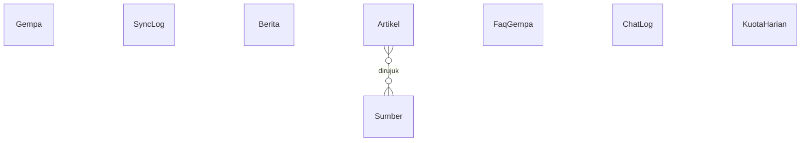

# PRD Tambahan: Database & Infrastruktur — SIGAP Gempa

Versi 0.2 · 2026-11-10 · Pelengkap `PRD.md` (bagian 1–13). Dokumen ini menggantikan asumsi lama "database belum wajib".

**Perubahan dari v0.1:** semua pertanyaan terbuka diputuskan (bagian 2); model `Gempa` diperbaiki (flag klasifikasi, kunci unik); ditambah `SyncLog`, `KuotaHarian`, fase pengerjaan, ERD, fallback statis, dan kriteria uji baru.

---

## 1. Ringkasan

SIGAP Gempa menambahkan lapisan data persisten: **PostgreSQL** (via **Prisma ORM**) sebagai database utama, dan **Redis** (opsional) sebagai penyimpan data sementara. Semuanya, termasuk aplikasi Next.js, berjalan di satu VPS milik sendiri dengan **Docker Compose**. MySQL tidak dipakai.

### 1.1 Tujuan
1. Menyimpan **riwayat gempa** dari BMKG agar tetap tampil saat BMKG tidak dapat diakses, serta bisa difilter dan dibuat grafik.
2. Mengelola **konten** (berita, edukasi, sumber, FAQ chatbot) tanpa deploy ulang.
3. Membuat **chatbot hemat kuota**: rate limit tahan restart, penghitung kuota harian, fallback bertingkat.
4. Menjadi bahan **laporan kuliah** (arsitektur, ERD, evaluasi chatbot).

### 1.2 Bukan tujuan
- Login/akun pengguna dan halaman admin.
- Data realtime lewat database: `autogempa` tetap diambil langsung dari BMKG dengan cache.
- Memakai MySQL.

---

## 2. Keputusan (menggantikan pertanyaan terbuka v0.1)

| # | Topik | Keputusan |
|---|---|---|
| 1 | Pembaruan data BMKG | **Cron di VPS** memanggil endpoint sinkronisasi tiap 5 menit (dilindungi `SYNC_SECRET`). Lazy refresh sebagai cadangan bila data terakhir lebih lama dari 10 menit. |
| 2 | Halaman admin | **Tidak ada.** Konten diubah lewat seed atau Prisma Studio via SSH tunnel. |
| 3 | Lokasi deploy | **Next.js ikut Docker di VPS yang sama.** Postgres tidak perlu dibuka ke internet. |
| 4 | Retensi `ChatLog` | **30 hari.** Ringkasan evaluasi chatbot diekspor ke laporan sebelum data dihapus. |
| 5 | Zona waktu reset kuota Gemini | **Perlu diverifikasi** di dokumentasi resmi Google sebelum fase 3. Sementara TTL dihitung dari konstanta zona waktu yang bisa diganti. |
| 6 | Domain & HTTPS | **Caddy** sebagai reverse proxy bila ada domain. Bila tidak, demo lewat IP/port 80. |
| 7 | Sumber `Berita` | **Input manual** (seed/Prisma Studio). Tanpa scraping atau RSS. |

---

## 3. Keputusan teknologi

| Komponen | Keputusan | Alasan singkat |
|---|---|---|
| Database utama | PostgreSQL | Tipe data kaya (timestamp, array, JSON) |
| ORM | Prisma | Skema deklaratif, migrasi, tipe TypeScript otomatis |
| Cache/pembatas | Redis (opsional, fase 4) | `INCR` + `EXPIRE` untuk rate limit, TTL untuk cache |
| Kontainer | Docker + Docker Compose | Lingkungan dev dan produksi sama |
| Reverse proxy | Caddy (opsional) | HTTPS otomatis |
| MySQL | Tidak dipakai | Tumpang tindih dengan Postgres |

---

## 4. Fase pengerjaan

| Fase | Isi | Kebutuhan terkait |
|---|---|---|
| 1 | Docker Compose + Postgres + Prisma, tabel `Gempa`, `SyncLog`, sinkronisasi BMKG, halaman riwayat, fallback saat BMKG gagal | FR-DB-01–04 |
| 2 | Konten: `Berita`, `Artikel`, `Sumber`, `FaqGempa`, seed idempoten, fallback statis | FR-DB-05–08, 14 |
| 3 | Chatbot: fallback bertingkat, `ChatLog`, `KuotaHarian` (di Postgres), rate limit in-memory | FR-DB-09, 11, 12 |
| 4 | Redis (opsional): rate limit, kuota, cache BMKG, cache chatbot | FR-DB-10, 13 |
| 5 | Hardening: backup + uji restore, firewall, uji penerimaan penuh | FR-DB-15, TC-DB-01–10 |

Fase 4 boleh dilewati; sistem tetap memenuhi semua kebutuhan **Wajib**.

---

## 5. Kebutuhan fungsional

| ID | Kebutuhan | Prioritas |
|---|---|---|
| FR-DB-01 | Data gempa BMKG disimpan ke tabel `Gempa` dengan **upsert**; kunci unik = `bmkgKey` (lihat 6.1). Jika BMKG merevisi magnitudo/koordinat, baris yang sama diperbarui. | Wajib |
| FR-DB-02 | Halaman riwayat membaca dari database (filter magnitudo, rentang tanggal, wilayah) dengan paginasi. | Wajib |
| FR-DB-03 | Jika BMKG gagal diakses, halaman menampilkan data terakhir dari database dengan keterangan "data terakhir diperbarui <waktu>". | Wajib |
| FR-DB-04 | Sinkronisasi berjalan lewat cron (+ lazy refresh cadangan), tanpa duplikat. Setiap eksekusi dicatat di `SyncLog`. | Wajib |
| FR-DB-05 | `Berita` menyimpan metadata saja (judul, sumber, tanggal, URL, ringkasan singkat), bukan isi penuh artikel. | Wajib |
| FR-DB-06 | Konten edukasi disimpan di `Artikel` per kategori dan slug. | Wajib |
| FR-DB-07 | `Artikel` terhubung ke satu atau lebih `Sumber`; daftar pustaka dihasilkan dari tabel ini. | Wajib |
| FR-DB-08 | Fallback chatbot membaca `FaqGempa` dari database. **Bila database tidak terjangkau, memakai FAQ inti statis di kode** (`src/data/fallback`). | Wajib |
| FR-DB-09 | Percakapan chatbot dicatat di `ChatLog`. IP disimpan sebagai HMAC, bukan mentah. Dihapus otomatis setelah 30 hari. | Disarankan |
| FR-DB-10 | Rate limit chatbot per IP memakai Redis (`INCR` + `EXPIRE`). Tanpa Redis, kembali ke in-memory. | Disarankan |
| FR-DB-11 | Penghitung kuota harian per model (tabel `KuotaHarian`, pindah ke Redis di fase 4). Bila kuota habis, langsung ke model cadangan lalu FAQ. Error 429 tetap ditangani sebagai fallback karena angka kuota bisa berubah. | Disarankan |
| FR-DB-12 | Fallback bertingkat: model utama → model cadangan → FAQ (DB) → FAQ statis, dengan pesan jelas ke pengguna. | Wajib |
| FR-DB-13 | Cache respons chatbot untuk pertanyaan identik. | Opsional |
| FR-DB-14 | Seed awal (FAQ, artikel, sumber, berita contoh) lewat `prisma db seed`, **idempoten** (upsert; dijalankan berulang tidak menduplikasi). | Wajib |
| FR-DB-15 | Backup `pg_dump` harian lewat cron, retensi **7 hari**, disimpan di luar container. | Wajib |

---

## 6. Model data

### 6.1 Gempa
| Kolom | Tipe | Catatan |
|---|---|---|
| id | String (cuid) | PK |
| bmkgKey | String | **Unik** = `DateTime` BMKG saja. Koordinat dan magnitudo tidak ikut kunci karena bisa direvisi. Dua gempa di detik yang sama dianggap tidak terjadi. |
| waktuUtc | DateTime | Dari `DateTime` BMKG (UTC) |
| lat, lon | Float | Dipisah dari string `Coordinates` |
| magnitudo | Float | BMKG mengirim string |
| kedalamanKm | Float | Buang " km" |
| wilayah | String | |
| potensiTeks | String | Teks asli |
| statusTsunami | Enum | `AMAN`, `BERPOTENSI`, `TIDAK_DINYATAKAN` |
| dirasakan | String? | Hanya ada di sebagian data |
| shakemapUrl | String? | Pola URL perlu diverifikasi |
| isAuto, isTerkini, isDirasakan | Boolean | Satu gempa bisa muncul di beberapa endpoint BMKG; upsert **hanya menyalakan** flag, tidak menimpanya. |
| createdAt, updatedAt | DateTime | |

Index: `waktuUtc` (desc), `magnitudo`, dan trigram (`pg_trgm`, GIN) pada `wilayah` lewat migrasi SQL manual.

### 6.2 SyncLog
`id`, `sumber` (autogempa/terkini/dirasakan), `status` (`OK`/`GAGAL`), `jumlahBaru`, `jumlahDiperbarui`, `pesanError?`, `durasiMs`, `createdAt`.

### 6.3 Berita
`id`, `judul`, `sumber`, `url` (unik), `tanggalTerbit`, `ringkasan?`, `createdAt`.

### 6.4 Artikel
`id`, `slug` (unik), `judul`, `kategori` (enum: `PENGERTIAN`, `PROSES`, `PENANGGULANGAN`, `MITIGASI`, `LAINNYA`), `isi` (markdown), `urutan`, `updatedAt`.

### 6.5 Sumber
`id`, `judul`, `penerbit`, `url` (unik), `tanggalAkses`; relasi many-to-many ke `Artikel`.

### 6.6 FaqGempa
`id`, `kataKunci` (String[]), `pertanyaan`, `jawaban`, `aktif` (Boolean).

### 6.7 ChatLog
`id`, `pertanyaan`, `jawaban`, `source` (enum `LLM`, `FALLBACK`), `model?`, `ipHash?` (HMAC dengan `LOG_HMAC_SECRET`), `createdAt`. Dihapus setelah 30 hari (cron). Pertanyaan pengguna bisa memuat data pribadi.

### 6.8 KuotaHarian
`id`, `model`, `tanggal` (sesuai zona waktu reset), `jumlah`; unik pada (`model`, `tanggal`).

### 6.9 ERD

---

## 7. Desain Redis (opsional, fase 4)

| Key | Isi | TTL |
|---|---|---|
| `rl:chat:{ipHash}` | Counter permintaan | 60 detik |
| `quota:gemini:{model}:{tanggal}` | Counter harian | Sampai reset kuota (zona waktu diverifikasi, lihat keputusan #5) |
| `bmkg:autogempa` | JSON terakhir | 60 detik |
| `bmkg:terkini` | JSON terakhir | 300 detik |
| `chat:cache:{hashPertanyaan}` | Jawaban | 1 jam |

Redis hanya untuk data yang boleh hilang. Data permanen ada di PostgreSQL.

---

## 8. Infrastruktur & keamanan

1. **Docker Compose**: service `app`, `postgres` (volume bernama, `healthcheck`, env `POSTGRES_USER/PASSWORD/DB`), `redis` bila dipakai (`requirepass`), `caddy` bila ada domain.
2. **Jaringan**: Postgres dan Redis tidak dibuka ke publik. Gunakan jaringan Docker internal atau `ports: "127.0.0.1:5432:5432"`. **Jangan mengandalkan `ufw` saja**, karena Docker menulis aturan iptables sendiri yang melewatinya. Akses dari lokal lewat SSH tunnel.
3. **Firewall** (`ufw`): hanya 22, 80, 443.
4. **User database khusus** `sigap` dengan hak terbatas; aplikasi tidak memakai superuser `postgres`.
5. **Rahasia** (`DATABASE_URL`, `REDIS_URL`, `SYNC_SECRET`, `LOG_HMAC_SECRET`) di `.env`, tidak di-commit; password di-URL-encode bila ada karakter khusus.
6. **Backup**: `pg_dump` harian, retensi 7 hari, di luar container, uji restore minimal sekali.
7. **Migrasi**: `prisma migrate dev` di lokal, `prisma migrate deploy` di VPS.
8. **Endpoint sinkronisasi** hanya menerima permintaan dengan header `SYNC_SECRET`.

---

## 9. Kebutuhan non-fungsional

| ID | Kebutuhan |
|---|---|
| NFR-DB-01 | Kueri riwayat (15 baris/halaman, termasuk filter wilayah) < 300 ms pada **data sintetis** 10.000 baris. BMKG hanya menyediakan puluhan data terakhir, jadi data uji dibuat lewat skrip. |
| NFR-DB-02 | Halaman utama tetap tampil walau database/Redis mati (degradasi anggun, bukan error layar penuh). |
| NFR-DB-03 | Tidak ada kredensial di repositori atau bundel klien. |
| NFR-DB-04 | Prisma Client memakai satu instance (singleton). |
| NFR-DB-05 | Backup terbukti dapat dipulihkan (satu kali uji restore). |

---

## 10. Dampak ke `PRD.md` utama

- Arsitektur: tambahkan PostgreSQL (dan Redis bila dipakai); konten statis dipindah dari `src/data/` ke database via seed, dengan salinan inti tetap di `src/data/fallback`.
- Chatbot: rate limit in-memory → Redis (fase 4); tambahkan fallback bertingkat dan penghitung kuota.
- Pertanyaan terbuka "perlu database/login?": **database ya, login belum**.
- API: `GET /api/gempa` (riwayat dari DB) dibuat; tambahkan `POST /api/sync` (dilindungi secret).

---

## 11. Kriteria penerimaan / uji

| ID | Skenario | Hasil yang diharapkan |
|---|---|---|
| TC-DB-01 | Sinkronisasi BMKG dua kali berturut-turut | Jumlah baris `Gempa` tidak bertambah untuk data yang sama |
| TC-DB-02 | Matikan akses ke BMKG, buka riwayat | Data terakhir tampil + keterangan waktu pembaruan |
| TC-DB-03 | Matikan container Postgres, buka beranda | Halaman tetap tampil (degradasi) |
| TC-DB-04 | 11 pesan chatbot dalam 1 menit dari IP sama | Pesan ke-11 ditolak dengan pesan rate limit |
| TC-DB-05 | Paksa error 429 dari model utama | Beralih ke model cadangan, lalu FAQ, dengan pesan jelas |
| TC-DB-06 | Cek port 5432 dan 6379 dari luar VPS | Tidak terjangkau |
| TC-DB-07 | Restore backup ke database kosong | Data kembali lengkap |
| TC-DB-08 | `prisma migrate deploy` di VPS | Berhasil tanpa mengubah data yang ada |
| TC-DB-09 | Cari `DATABASE_URL` di repositori dan bundel klien | Tidak ditemukan |
| TC-DB-10 | Jalankan `prisma db seed` dua kali | Jumlah baris tidak bertambah |
| TC-DB-11 | BMKG merevisi magnitudo gempa yang sama, lalu sinkronisasi | Baris diperbarui, tidak ada duplikat |
| TC-DB-12 | Gempa muncul di `autogempa` lalu `terkini` | Satu baris, kedua flag menyala |
| TC-DB-13 | Matikan Postgres, kirim pertanyaan chatbot | Dijawab dari FAQ statis |
| TC-DB-14 | Panggil endpoint sinkronisasi tanpa `SYNC_SECRET` | Ditolak (401) |

---

## 12. Risiko

| Risiko | Dampak | Mitigasi |
|---|---|---|
| Kuota Gemini kecil (asumsi 20 permintaan/hari/model; bisa berubah) | Chatbot sering jatuh ke FAQ | Fallback bertingkat, penghitung kuota, FAQ berkualitas, tangani 429 |
| Port database terbuka | Data bocor | Bind lokal, firewall, SSH tunnel, password kuat, TC-DB-06 |
| Perubahan format BMKG | Sinkronisasi gagal | Normalisasi defensif, simpan `potensiTeks` asli, `SyncLog` |
| Sinkronisasi mati lama | Celah pada riwayat | `SyncLog` + lazy refresh; tulis keterbatasan di laporan |
| VPS mati saat demo | Aplikasi tidak bisa diakses | Data demo/rekaman layar, uji sehari sebelumnya |
| Versi Prisma berubah | Konfigurasi tidak cocok | Ikuti dokumentasi resmi versi terpasang |

---

## 13. Pertanyaan yang masih perlu diverifikasi

1. Zona waktu reset kuota harian Gemini dan angka kuota terkini (dokumentasi resmi Google).
2. Pola URL `shakemapUrl` BMKG.
3. Apakah ada domain untuk demo (menentukan perlu tidaknya Caddy).
