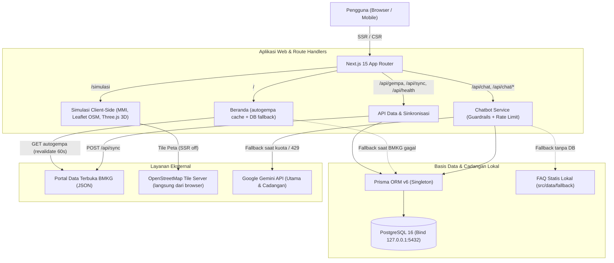

<div align="center">

<picture>
  <source media="(prefers-color-scheme: dark)" srcset="./public/logo/logo-white.svg" />
  
</picture>

### *Sistem Informasi Gempa Bumi, Simulasi Dampak & Asisten Edukasi Mitigasi Indonesia*

[](https://nextjs.org/)
[](https://react.dev/)
[](https://www.typescriptlang.org/)
[](https://tailwindcss.com/)
[](https://www.postgresql.org/)
[](https://www.prisma.io/)
[](https://leafletjs.com/)
[](https://threejs.org/)
[](https://www.docker.com/)
[](https://ai.google.dev/)

<p align="center">
  Portal informasi gempa bumi Indonesia berbasis data terbuka BMKG, arsip riwayat persisten PostgreSQL, simulator dampak seismik 100% di sisi klien (Peta Dampak Leaflet & Getaran 3D Three.js), asisten edukasi AI dengan fallback bertingkat, serta materi kesiapsiagaan kebencanaan.
</p>

[Halaman & Fitur](#halaman--fitur-utama) ·
[Arsitektur Sistem](#arsitektur-sistem) ·
[Model Basis Data](#model-basis-data) ·
[Instalasi & Menjalankan](#panduan-instalasi--menjalankan-sistem) ·
[Spesifikasi API](#spesifikasi-endpoint-api) ·
[Pengujian](#pengujian)

</div>

---

> **Disclaimer Penting:** **SIGAP bukan sistem peringatan dini resmi.** Otoritas tunggal informasi gempa bumi dan peringatan dini tsunami di Indonesia adalah **BMKG**. Seluruh hasil kalkulasi maupun visualisasi pada halaman simulasi merupakan **estimasi edukasi, bukan data resmi BMKG**.

---

## Ringkasan Masalah & Pendekatan

1. **Ketergantungan pada Satu Sumber**: Saat terjadi gempa besar dan lalu lintas ke portal BMKG melonjak, pengguna tetap memerlukan akses riwayat gempa yang stabil. SIGAP menyinkronkan data ke **PostgreSQL** dan mencatat waktu pembaruan di **`SyncLog`** agar halaman riwayat serta beranda dapat berdegradasi dengan aman.
2. **Pemahaman Parameter Teknis**: Angka magnitudo, kedalaman hiposenter, dan koordinat sering sulit dibayangkan dampaknya oleh pelajar maupun masyarakat umum. Simulator sisi klien SIGAP menerjemahkan parameter tersebut menjadi skala intensitas **MMI (I–XII)**, radius jangkauan terasa/merusak di peta, waktu tiba gelombang **P–S**, energi seismik, dan ilustrasi getaran 3D.
3. **Keterbatasan Kuota AI**: Integrasi LLM rentan terbentur batas kuota harian (*rate limit* / HTTP `429`). Layanan chatbot SIGAP memakai mekanisme **fallback bertingkat** dari model utama, model cadangan, FAQ database (`FaqGempa`), hingga FAQ statis lokal (`src/data/fallback`).

---

## Halaman & Fitur Utama

### 1. Beranda (`/`)
* Menampilkan **data gempa terbaru (`autogempa`)** langsung dari BMKG dengan cache `revalidate` 60 detik, termasuk magnitudo, lokasi episentrum, status potensi tsunami, waktu WIB, kedalaman, koordinat LS/BT, dan informasi wilayah dirasakan.
* Menyertakan **degradasi otomatis ke PostgreSQL** disertai penanda waktu sinkronisasi terakhir dari `SyncLog` apabila BMKG tidak dapat diakses.
* Menyediakan daftar gempa dirasakan terkini, pratinjau skenario gempa bersejarah, pintasan ke simulator/riwayat/chatbot, serta tautan edukasi mitigasi.

### 2. Riwayat Gempa (`/riwayat`)
* Membaca arsip kejadian gempa dari PostgreSQL dengan **upsert idempoten** berbasis kunci unik `bmkgKey` (`DateTime` BMKG), di mana flag `isAuto`, `isTerkini`, dan `isDirasakan` hanya dinyalakan (tidak pernah ditimpa mati).
* Mendukung filter **magnitudo minimal**, **rentang tanggal (`dari`, `sampai`)**, **wilayah**, dan **tipe** (`auto`, `terkini`, `dirasakan`), dilengkapi grafik ringkas, paginasi 15 item per halaman, serta tombol **Simulasikan** yang mengirim parameter gempa ke `/simulasi`.

### 3. Simulasi Dampak Edukatif (`/simulasi`)
* Seluruh perhitungan berlangsung **100% di sisi klien** (`src/lib/simulasi` dan `src/lib/simulasi-visual`) tanpa memicu kueri database saat slider atau parameter digeser.
* Menyediakan **3 kontrol utama** (magnitudo, kedalaman `10 / 70 / 200 km`, jarak pengamat `0–300 km`), daftar **preset skenario bersejarah** dari `SkenarioSimulasi`, serta panel **Detail lanjutan** yang tertutup secara default:
  * **Mode Peta Dampak (Default)**: Menggunakan **Leaflet `1.9.4`** + tile OpenStreetMap (dimuat dinamis `ssr: false`) dengan penanda episentrum dan titik pengamat interaktif (klik, seret, keyboard, atau input koordinat manual), perhitungan jarak **Haversine**, serta lingkaran radius terasa (`MMI >= III`) dan merusak ringan (`MMI >= VI`) dalam batas rentang kalibrasi `Mw 5,0–7,9` dan `<= 300 km`.
  * **Mode Getaran 3D**: Visualisasi ruangan *low-poly* menggunakan **Three.js `0.187.0`** (chunk dimuat dinamis hanya saat tab Getaran 3D dibuka) dengan efek animasi ilustratif terpisah dari kutipan resmi deskripsi skala MMI BMKG.
* **Model Perhitungan** (terdokumentasi di [`docs/rumus-simulasi.md`](docs/rumus-simulasi.md)):
  * Atenuasi intensitas MMI: **Allen, Wald & Worden (2012)** (`AllenEtAl2012Rhypo`).
  * Radius guncangan ambang MMI III dan VI: pencarian numerik metode *bisection* pada `[0, 300] km`.
  * Energi seismik (**Gutenberg–Richter**): $\log_{10} E = 1{,}5 M + 4{,}8$ (dalam Joule).
  * Waktu rambat gelombang kerak rata-rata: $V_P = 6{,}0\text{ km/s}$, $V_S = 3{,}5\text{ km/s}$, dan *Golden Time* ($t_S - t_P$).
  * Indikator kriteria tsunami (rujukan *Buku Saku BNPB, 2012*): tipe lokasi `LAUT`, $M > 6{,}8$, kedalaman $\le 70\text{ km}$ (dengan 3 keadaan pada mode Kustom hingga lokasi `Darat`/`Laut` dipilih).

### 4. Chatbot Mitigasi Kontekstual (`/chatbot`)
* **Injeksi Konteks Faktual**: Menyertakan ringkasan gempa terbaru (`autogempa`) dan 3 gempa terakhir dari database ke dalam *system prompt*, dilengkapi *guardrails* untuk pertanyaan di luar topik kegempaan dan upaya *prompt injection*.
* **Fallback Bertingkat 4 Lapis**:
  1. Model utama Gemini (default `.env.example`: `gemini-3.5-flash-lite`)
  2. Model cadangan Gemini (default `.env.example`: `gemini-4-hydrogen`)
  3. Pencocokan kata kunci ke basis pengetahuan **`FaqGempa`** di PostgreSQL
  4. FAQ statis lokal (**`STATIC_FAQS`**) bila database juga tidak terjangkau
* **Keamanan, Kuota & Evaluasi**: Rate limit 10 pesan/menit/IP (`ipHash` menggunakan HMAC-SHA256 `LOG_HMAC_SECRET`), pelacak kuota harian `KuotaHarian`, pencatatan latensi `responseTimeMs`, umpan balik satu kali per jawaban (`POST /api/chat/feedback`), dan endpoint pembersihan log > 30 hari (`POST /api/chat/cleanup`).

### 5. Edukasi & Pustaka (`/edukasi` & `/edukasi/[slug]`)
* Artikel edukasi kesiapsiagaan bencana yang disimpan dalam berkas Markdown terstruktur di `content/`, terhubung dengan katalog **`Sumber`** (BMKG, BNPB, dan rujukan terkait) serta daftar berita terkurasi (**`Berita`**).

---

## Arsitektur Sistem



---

## Model Basis Data

Dikelola deklaratif di [`prisma/schema.prisma`](prisma/schema.prisma):

| Model | Fungsi Utama | Kolom / Kunci Penting |
| :--- | :--- | :--- |
| `Gempa` | Katalog riwayat gempa tersinkronisasi BMKG | `bmkgKey` (unique), `waktuUtc`, `magnitudo`, `isAuto`, `isTerkini`, `isDirasakan` |
| `SyncLog` | Audit durasi, status (`OK`/`ERROR`), dan jumlah data per sinkronisasi | `sumber`, `status`, `durasiMs`, `createdAt` |
| `Berita` | Metadata berita kebencanaan terkurasi | `url` (unique), `sumber`, `tanggalTerbit` |
| `Artikel` | Artikel edukasi kebencanaan per kategori | `slug` (unique), `kategori`, `urutan` |
| `Sumber` | Daftar pustaka rujukan resmi | `url` (unique), relasi ke `Artikel` & `SkenarioSimulasi` |
| `FaqGempa` | Basis aturan pencocokan FAQ chatbot | `pertanyaan` (unique), `kataKunci`, `aktif` |
| `ChatLog` | Riwayat percakapan, waktu respons, dan penilaian `isHelpful` | `id` (cuid), `source`, `responseTimeMs`, `ipHash`, `createdAt` |
| `KuotaHarian` | Penghitung penggunaan kuota harian per model AI | `[model, tanggal]` (unique), `jumlah` |
| `SkenarioSimulasi` | Preset gempa bersejarah untuk halaman `/simulasi` | `nama` (unique), `magnitudo`, `kedalamanKm`, `lat`, `lon`, `tipeLokasi` |

---

## Panduan Instalasi & Menjalankan Sistem

### Prasyarat
* **Node.js** versi `20+`
* **Docker** & **Docker Compose** (untuk menjalankan PostgreSQL 16)

### 1. Kloning Repositori & Instal Dependensi
```bash
git clone https://github.com/MuhammadFakhirAndito/Sigap.git
cd Sigap
npm install
```

### 2. Konfigurasi Variabel Lingkungan (`.env`)
Salin contoh konfigurasi dari `.env.example`:
```bash
cp .env.example .env
```
Sesuaikan nilai variabel di `.env` (buat nilai acak lewat `openssl rand -hex 32`; lihat [`.env.example`](.env.example)):
```env
POSTGRES_ADMIN_USER="pgadmin"
POSTGRES_ADMIN_PASSWORD="<password-admin-acak>"
POSTGRES_APP_PASSWORD="<password-aplikasi-acak>"
DATABASE_URL="postgresql://sigap:<password-aplikasi-acak>@127.0.0.1:5432/sigap?schema=public"

SYNC_SECRET="<rahasia-sync-acak>"
LOG_HMAC_SECRET="<rahasia-hmac-acak>"
NEXT_PUBLIC_APP_URL="http://localhost:3000"

NEXT_PUBLIC_MAP_TILE_URL="https://tile.openstreetmap.org/{z}/{x}/{y}.png"
NEXT_PUBLIC_MAP_TILE_ATTRIBUTION='© <a href="https://www.openstreetmap.org/copyright" target="_blank" rel="noopener noreferrer">OpenStreetMap contributors</a>'

GEMINI_API_KEY="<gemini-api-key-anda>"
GEMINI_PRIMARY_MODEL="gemini-3.5-flash-lite"
GEMINI_FALLBACK_MODEL="gemini-4-hydrogen"
```

### 3. Jalankan PostgreSQL dengan Docker Compose
```bash
docker compose up -d postgres
```
> **Catatan Keamanan**: Container `sigap_postgres` pada [`docker-compose.yml`](docker-compose.yml) mengikat port ke `127.0.0.1:5432`. Bootstrap awal memakai peran admin terpisah (`pgadmin`) lewat `docker-entrypoint-initdb.d`, sedangkan aplikasi dan `prisma migrate deploy` memakai peran `sigap` (`NOSUPERUSER NOCREATEDB NOCREATEROLE`). Password contoh lama yang pernah ada di riwayat Git awal tidak boleh dipakai di produksi.

### 4. Migrasi Skema & Seed Konten Idempoten
```bash
npm run prisma:generate
npx prisma migrate deploy
npx prisma db seed
```

### 5. Jalankan Aplikasi Web
```bash
# Mode pengembangan
npm run dev

# Atau mode produksi
npm run build
npm start
```
Buka [http://localhost:3000](http://localhost:3000) di browser. Untuk menjalankan aplikasi sekaligus database di Docker:
```bash
docker compose up -d --build
```

---

## Spesifikasi Endpoint API

| Method | Endpoint | Autentikasi | Deskripsi & Parameter |
| :--- | :--- | :--- | :--- |
| `GET` | `/api/gempa` | Publik | Daftar gempa dari PostgreSQL dengan metadata sinkronisasi terakhir. Query: `mag`, `dari`, `sampai`, `wilayah`, `hal`, `limit` (maks. `50`), `tipe` (`dirasakan`/`terkini`/`auto`). |
| `POST` | `/api/sync` | Header `x-sync-secret` atau `Authorization: Bearer` | Menjalankan sinkronisasi BMKG ke DB dan mencatat ke `SyncLog`. Query opsional: `source=autogempa\|terkini\|dirasakan`. |
| `GET` | `/api/health` | Publik (ringkas) / Secret (detail) | Publik mengembalikan `{ status: "healthy" \| "degraded" }`. Dengan `SYNC_SECRET` mengembalikan latensi koneksi DB dan waktu `SyncLog` `OK` terakhir. |
| `POST` | `/api/chat` | Publik (terbatas rate limit) | Chatbot mitigasi dengan rate limit 10 pesan/menit/IP. Body: `{ "message": string, "history"?: array, "pageContextNote"?: string }`. |
| `POST` | `/api/chat/feedback` | Publik (1x per `chatLogId`) | Menyimpan penilaian 👍/👎 ke `ChatLog`. Body: `{ "chatLogId": string, "isHelpful": boolean }`. Menolak ID palsu atau penilaian ganda. |
| `POST` | `/api/chat/cleanup` | Header `x-sync-secret` atau `Authorization: Bearer` | Menghapus catatan `ChatLog` yang berusia lebih dari 30 hari. |

---

## Pengujian

Jalankan pemeriksaan tipe, linter, dan rangkaian pengujian **Vitest** (memerlukan instance PostgreSQL `sigap_postgres` aktif untuk pengujian integrasi DB):

```bash
npx tsc --noEmit
npm run lint
npm run test
```

Rangkaian uji pada direktori [`tests/`](tests/) mencakup validasi kalkulasi simulasi MMI/energi/gelombang (`tests/simulasi.test.ts`), fungsi visual peta & pemetaan getaran 3D (`tests/simulasi-visual.test.ts`), utilitas riwayat (`tests/riwayat-lib.test.ts`), parser Markdown (`tests/markdown.test.ts`), validasi seed idempoten (`tests/seed-validation.test.ts`), serta pengujian kepatuhan integrasi database, keamanan, rate limit, dan fallback chatbot (`tests/tc-db-fase1.test.ts`, `tests/tc-db-fase1c.test.ts`, `tests/tc-db-fase3.test.ts`).

---

## Struktur Direktori Proyek

```plaintext
SIGAP/
├── content/                 # Artikel edukasi Markdown, berita, & sumber terkurasi
├── docs/                    # Spesifikasi layar, rumus simulasi, & tangkapan layar verifikasi
├── prisma/
│   ├── migrations/          # Riwayat migrasi SQL PostgreSQL
│   ├── schema.prisma        # Skema Prisma ORM (9 model)
│   └── seed.ts              # Seeder idempoten (artikel, berita, sumber, FAQ, skenario)
├── public/
│   ├── images/              # Aset visual beranda
│   └── logo/                # Aset logo SVG (primary, black, white, symbol, wordmark)
├── scripts/                 # Skrip verifikasi visual, benchmark kueri, & utilitas aset
├── src/
│   ├── app/
│   │   ├── api/             # Route handlers (/gempa, /sync, /health, /chat/*)
│   │   ├── chatbot/         # Halaman asisten edukasi SIGAP
│   │   ├── design/          # Halaman referensi token desain
│   │   ├── edukasi/         # Daftar materi edukasi & detail artikel (/edukasi/[slug])
│   │   ├── riwayat/         # Arsip gempa dengan filter & grafik ringkas
│   │   ├── simulasi/        # Simulator dampak dual-mode (Peta Leaflet & Getaran 3D)
│   │   ├── globals.css      # Token CSS Tailwind v4 (@theme dari DESIGN.md)
│   │   └── page.tsx         # Halaman Beranda
│   ├── components/          # Komponen UI (beranda, chat, edukasi, simulasi, ui)
│   ├── data/fallback/       # FAQ statis darurat saat LLM & database tidak tersedia
│   ├── lib/                 # Klien BMKG, logika chatbot, mesin simulasi, utilitas Prisma & Markdown
│   └── types/               # Definisi tipe TypeScript
├── tests/                   # Pengujian unit dan integrasi Vitest
├── .env.example             # Contoh konfigurasi environment
├── docker-compose.yml       # Layanan PostgreSQL 16 & container aplikasi
├── Dockerfile               # Build multi-stage image produksi Next.js
└── package.json             # Dependensi & skrip NPM
```

---

## Atribusi & Sumber Data

* **Data Kegempaan**: Portal Data Terbuka [Badan Meteorologi, Klimatologi, dan Geofisika (BMKG)](https://data.bmkg.go.id/).
* **Peta Interaktif**: [Leaflet](https://leafletjs.com/) dengan tile peta dari [OpenStreetMap contributors](https://www.openstreetmap.org/copyright) (permintaan tile dikirim langsung dari peramban pengguna ke server OSM).
* **Visualisasi 3D**: [Three.js](https://threejs.org/) (`MIT License`).
* **Rujukan Ilmiah Simulator**: Allen, T. I., Wald, D. J., & Worden, C. B. (2012) & *Buku Saku Tanggap Tangkas Tangguh Menghadapi Bencana* (BNPB, 2012). Detail lengkap pada [`docs/rumus-simulasi.md`](docs/rumus-simulasi.md).
