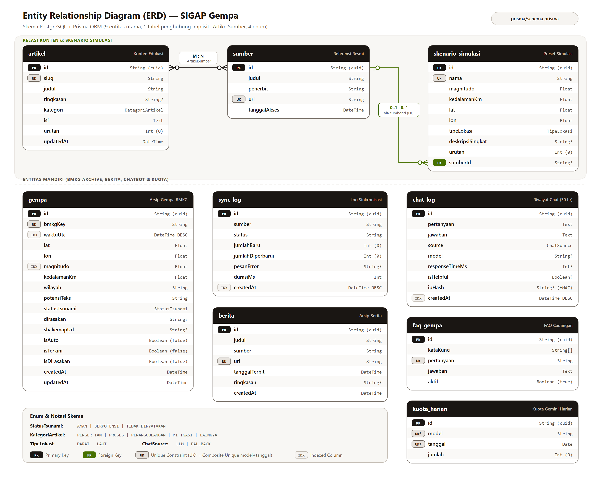
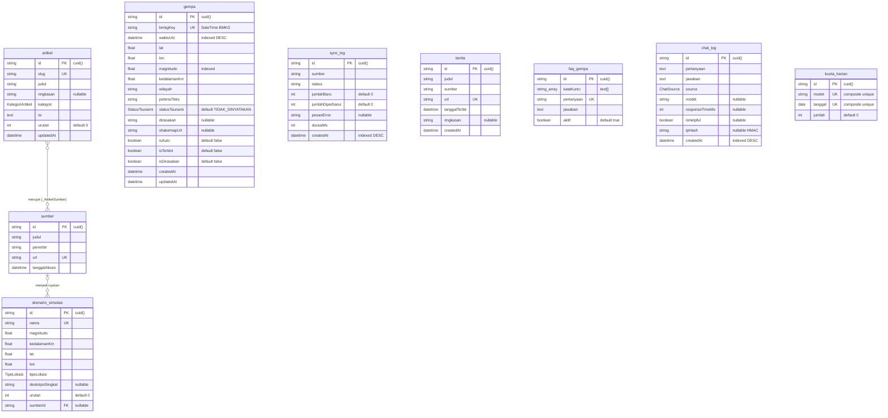

# Entity Relationship Diagram (ERD) — SIGAP Gempa

Dokumentasi skema basis data PostgreSQL SIGAP Gempa sesuai [prisma/schema.prisma](../prisma/schema.prisma).

## Gambar ERD

> Versi vektor juga tersedia di [ERD.svg](./ERD.svg) dan versi PNG resolusi tinggi di [ERD.png](./ERD.png).

## Diagram ERD (Mermaid)

## Ringkasan Relasi

| Relasi | Kardinalitas | Implementasi di PostgreSQL |
| :--- | :---: | :--- |
| `artikel` ↔ `sumber` | Many-to-Many (`0..*` : `0..*`) | Tabel penghubung implisit Prisma `_ArtikelSumber` (`A` → `artikel.id`, `B` → `sumber.id`). |
| `sumber` → `skenario_simulasi` | One-to-Many opsional (`0..1` : `0..*`) | Foreign key opsional `skenario_simulasi.sumberId` mengacu ke `sumber.id`. |
| `gempa`, `sync_log`, `berita`, `faq_gempa`, `chat_log`, `kuota_harian` | Entitas mandiri | Tidak memiliki foreign key ke tabel lain; dipakai oleh fitur sinkronisasi BMKG, arsip berita, dan chatbot. |

## Enum

- **`StatusTsunami`:** `AMAN`, `BERPOTENSI`, `TIDAK_DINYATAKAN`
- **`KategoriArtikel`:** `PENGERTIAN`, `PROSES`, `PENANGGULANGAN`, `MITIGASI`, `LAINNYA`
- **`TipeLokasi`:** `DARAT`, `LAUT`
- **`ChatSource`:** `LLM`, `FALLBACK`

## Indeks & Kunci Unik Penting

- **`gempa`:** `UNIQUE(bmkgKey)`, `INDEX(waktuUtc DESC)`, `INDEX(magnitudo)`
- **`sync_log`:** `INDEX(createdAt DESC)`
- **`chat_log`:** `INDEX(createdAt DESC)`
- **`kuota_harian`:** `UNIQUE(model, tanggal)`
- **`artikel`, `sumber`, `berita`, `faq_gempa`, `skenario_simulasi`:** masing-masing memiliki kunci unik (`slug`, `url`, `pertanyaan`, `nama`) untuk mendukung `upsert` seed idempoten.
